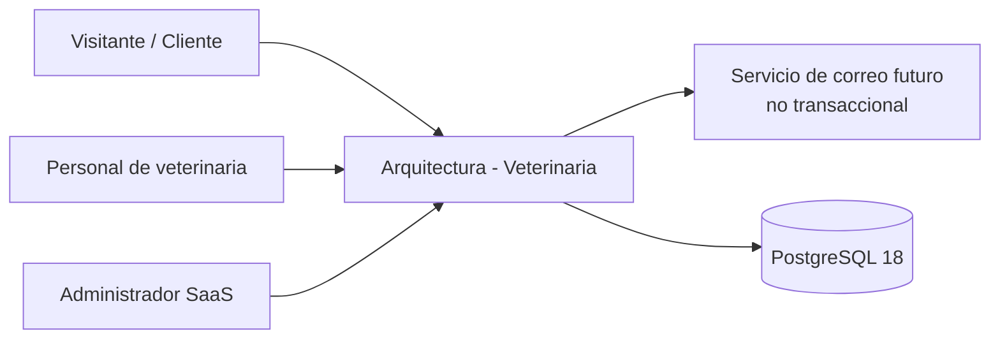
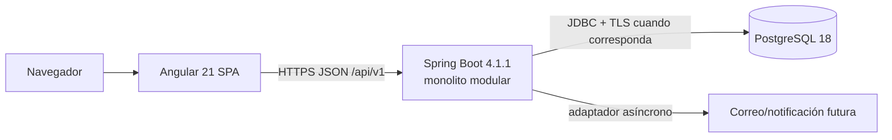
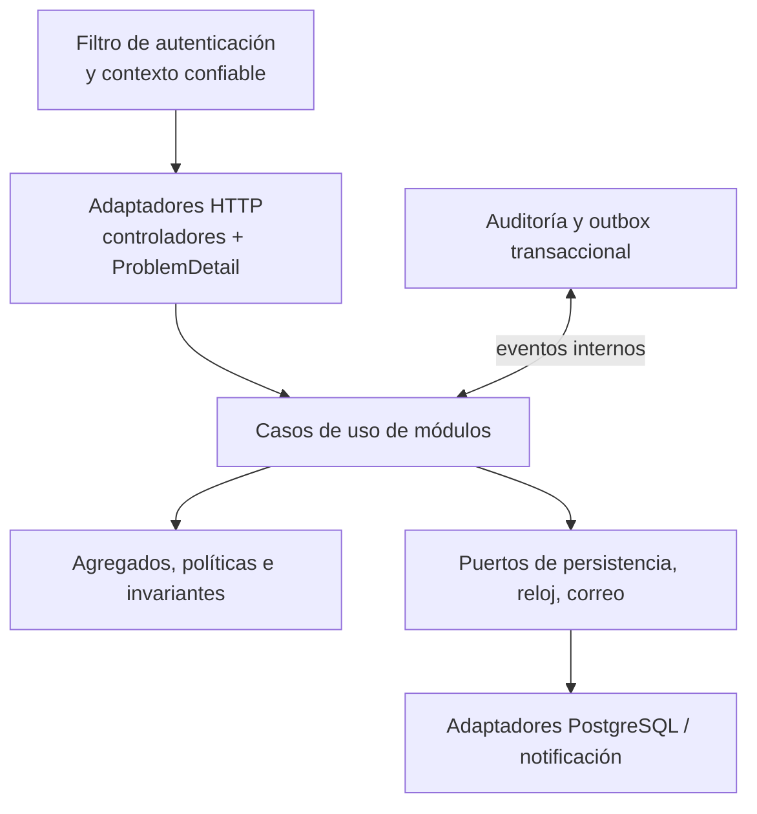

# G2 — arc42 y C4

## 1. Contexto y objetivo (arc42)

El sistema es un SaaS académico para veterinarias independientes del Perú. Gestiona identidades, operación clínica, agenda, inventario único, POS y pedidos web con datos sintéticos. Su éxito técnico mínimo es proteger el tenant y las reglas invariantes mientras permite demostrar flujos verticales reales.

No es una plataforma de salud humana, no procesa pagos en línea ni emite comprobantes tributarios. No se le atribuye cumplimiento legal o producción real por esta arquitectura.

## 2. Restricciones

- Stack y fechas definidos en `AGENTS.md`.
- Presupuesto inicial S/ 0; ninguna alternativa obliga una compra.
- Un solo producto modular, sin aplicación demo paralela.
- La interfaz nunca accede a PostgreSQL directamente.
- V1 prohíbe exponer historia clínica completa al cliente y exige aislamiento por tenant, trazabilidad, idempotencia y stock no negativo.

## 3. Contexto C4 — nivel 1

El sistema devuelve un resultado de negocio aun si falla una notificación posterior. Los proveedores de correo y hosting son adaptadores reemplazables, no fuentes de autoridad.

## 4. Contenedores C4 — nivel 2

En producción se prefiere servir el bundle Angular desde el mismo origen del monolito para reducir CORS y proteger cookies de sesión. En desarrollo, Angular puede ejecutar un servidor separado con CORS restringido a un origen local documentado. La representación C4 describe objetivo, no servicios desplegados.

## 5. Componentes C4 — nivel 3

Los controladores no contienen reglas de negocio ni reciben un `tenantId` de confianza desde el cuerpo. Los casos de uso demandan un `ActorContext` autenticado y los adaptadores aplican el alcance de tenant en transacción.

## 6. Escenarios arquitectónicos significativos

| Escenario | Respuesta arquitectónica | Evidencia futura |
|---|---|---|
| Cliente manipula un ID ajeno | `ActorContext`, autorización de recurso y RLS; respuesta 404/403 según política de no enumeración | integración de seguridad |
| Dos canales venden la última unidad | fila de saldo bloqueada, operación idempotente y movimiento único | prueba de concurrencia PostgreSQL |
| Dos reservas coinciden | restricción temporal y transacción de confirmación | prueba de concurrencia de agenda |
| Correo falla tras acción válida | outbox/estado de entrega separado; no revierte transacción | integración de notificación simulada |
| Tenant suspendido | guardia transversal en casos de uso y política RLS; conserva historia | pruebas de autorización por módulo |

## 7. Riesgos y deuda deliberadamente no asumida

No se incorpora un bus externo, microservicios, caché distribuida, almacenamiento de archivos ni pagos en línea en V1. Si un nuevo requisito vuelve volátil alguno de esos límites, se abrirá un ADR y no se perforará el monolito modular por conveniencia.
