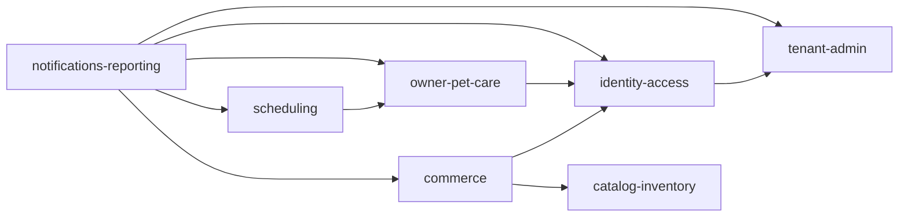

# G2 — DDD estratégico, módulos y dependencias

## Lenguaje ubicuo y límites

| Módulo | Responsabilidad exclusiva | Agregados iniciales | No es responsable de |
|---|---|---|---|
| `tenant-admin` | veterinaria, estado, RUC y configuración de delivery | Tenant, RucReview, DeliveryPolicy | sesiones, notas clínicas |
| `identity-access` | cuentas separadas, roles, sesiones, tokens de un uso | StaffAccount, ClientAccount, Session, OneTimeToken | reglas clínicas o comerciales |
| `owner-pet-care` | propietario, mascota, vínculo, transferencia y clínica | Owner, Pet, OwnershipPeriod, ClinicalEpisode | confirmar agenda o descontar stock |
| `scheduling` | disponibilidad, solicitudes, reserva y grooming | Availability, Appointment, GroomingService | emitir venta automática |
| `catalog-inventory` | producto, saldo, kardex y ajuste | Product, InventoryBalance, StockMovement | estados de pedido |
| `commerce` | POS, pedido, pago manual, entrega, cancelación y devolución | PosSale, OnlineOrder, PaymentRecord, Return | calcular saldo directamente |
| `notifications-reporting` | auditoría, outbox, notificaciones y lecturas operativas | AuditEntry, Notification, OutboxMessage | ser fuente de hechos comerciales |

## Reglas de dependencia

Las flechas significan que un módulo puede usar un puerto o publicar/consumir un evento de contrato estable; no permiten consultar repositorios internos ni tablas ajenas. `catalog-inventory` es la única autoridad de movimientos y saldo. `notifications-reporting` consume eventos confirmados y no inicia cambios de negocio.

## Arquitectura hexagonal selectiva

Se aplica una capa de puertos a persistencia, reloj, seguridad, correo, almacenamiento de archivos y proveedores externos. Para una consulta interna simple dentro de un mismo módulo, no se añade una abstracción ceremonial si no protege una dependencia variable. Cada agregado conserva sus invariantes en dominio/aplicación; JPA y HTTP son adaptadores, no el modelo de negocio.

## Eventos internos de contrato

Los contratos listados en B06 se mantienen como eventos internos versionados: `PetOwnershipValidated`, `AppointmentConfirmed`, `GroomingCompleted`, `InventoryDecrementRequested`, `OnlineOrderConfirmed`, `OrderCancelledBeforeDispatch`, `ReturnInspected`, `TenantSuspended`, `TenantReactivated`, `WorkerDeactivated` y `RolesChanged`.

Un evento se publica solo después de la transacción que hace verdadero el hecho. La futura implementación conservará una entrada outbox antes de intentar correo. La notificación no es una dependencia para confirmar una operación comercial o clínica.

## Reglas de integración entre módulos

- Las referencias entre módulos son identificadores y DTO de contrato, no entidades JPA compartidas.
- Las consultas de lectura deben pasar por un caso de uso dueño del dato o por una proyección explícita.
- Cambios en eventos, API, esquema o políticas de tenant son cambios coordinados: un responsable de escritura y un revisor independiente.
- Una prueba que cubre una invariante compartida se implementa como integración contra PostgreSQL real, además de las pruebas unitarias del módulo.
